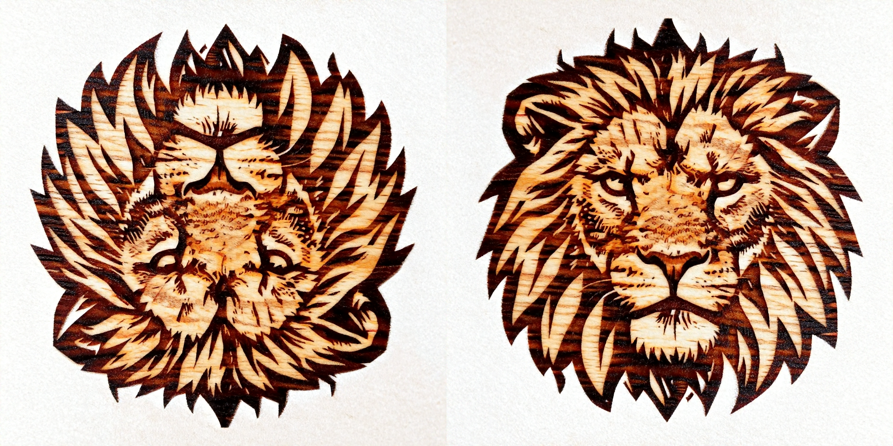
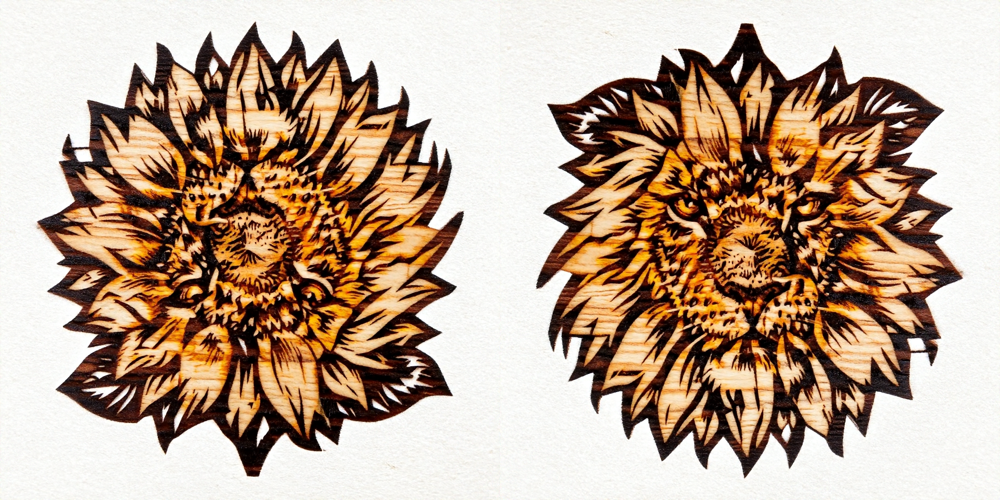
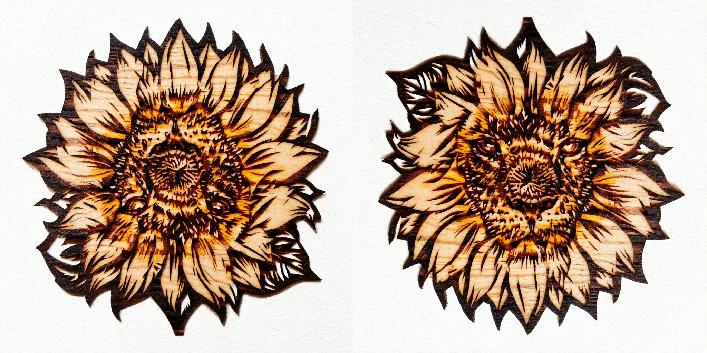
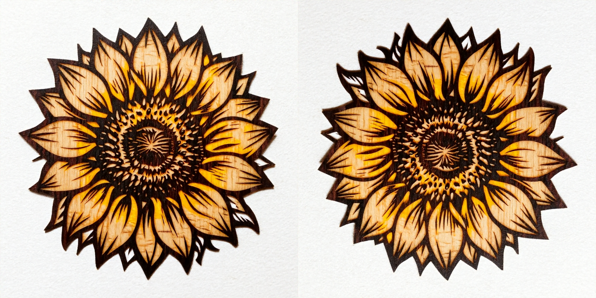
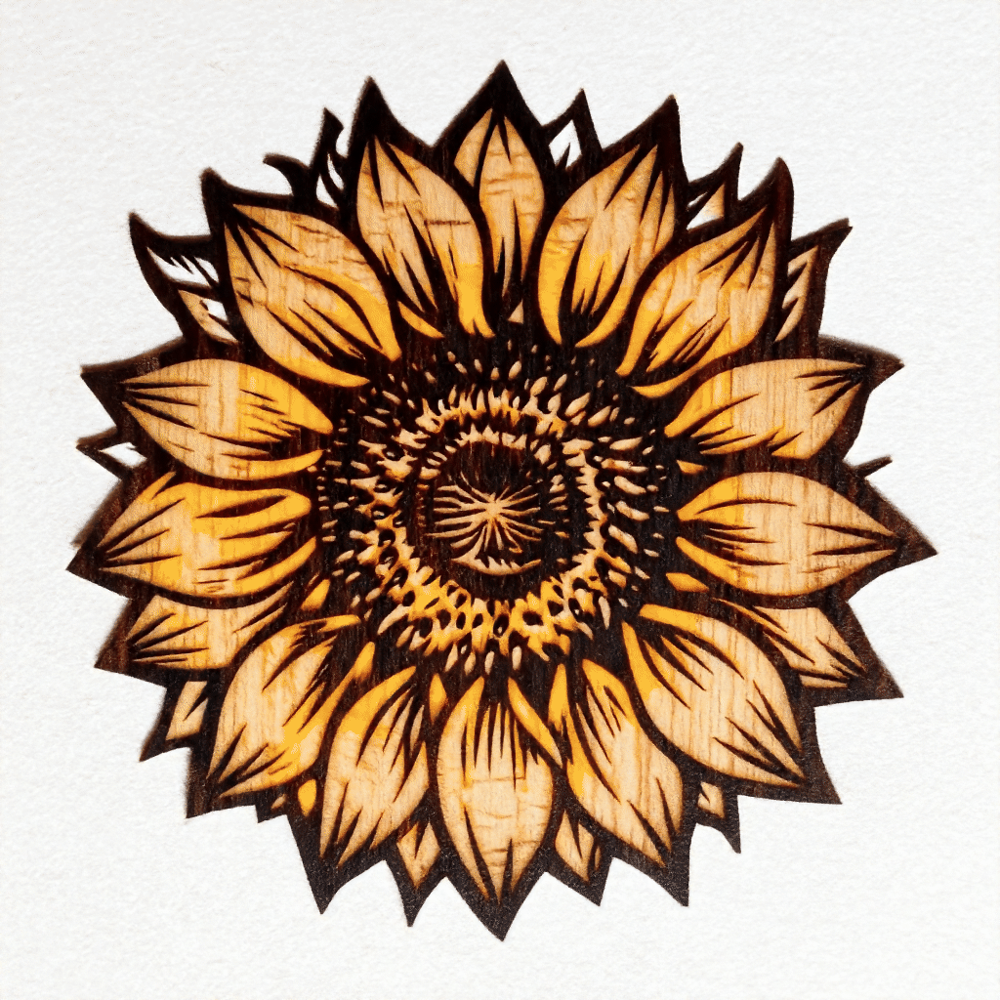
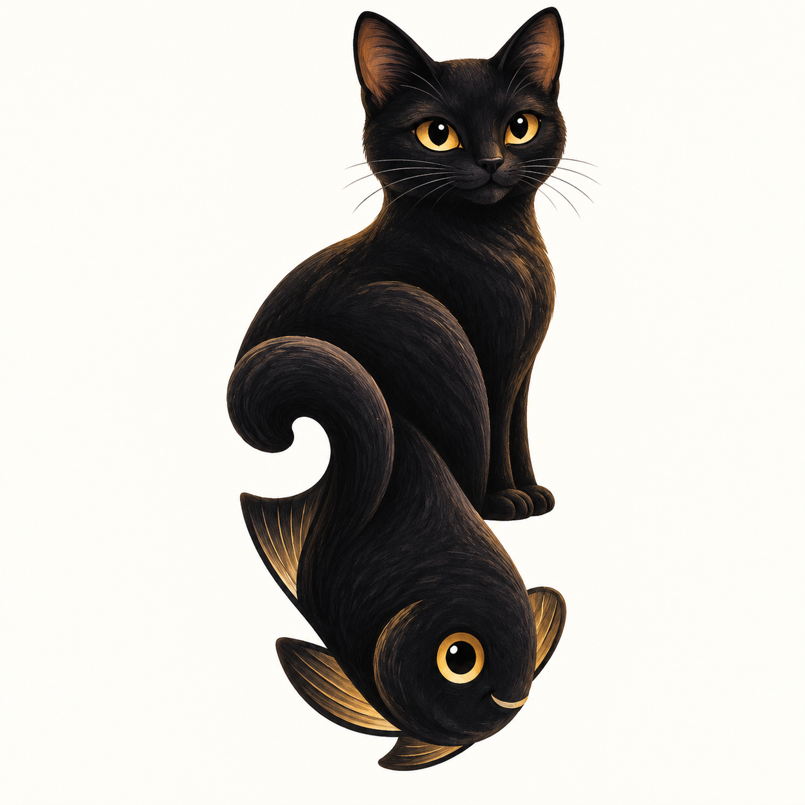
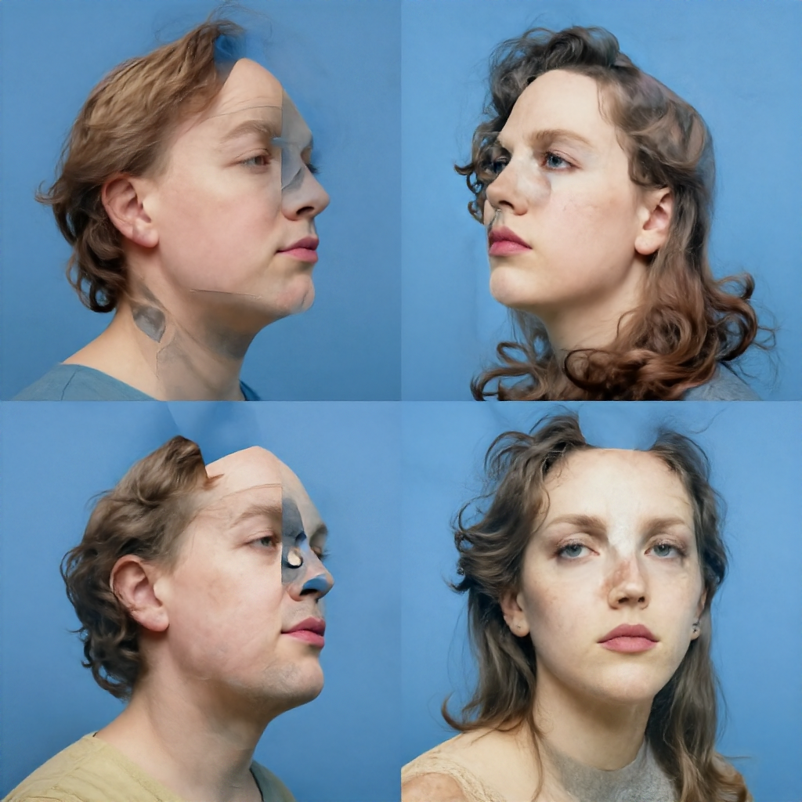
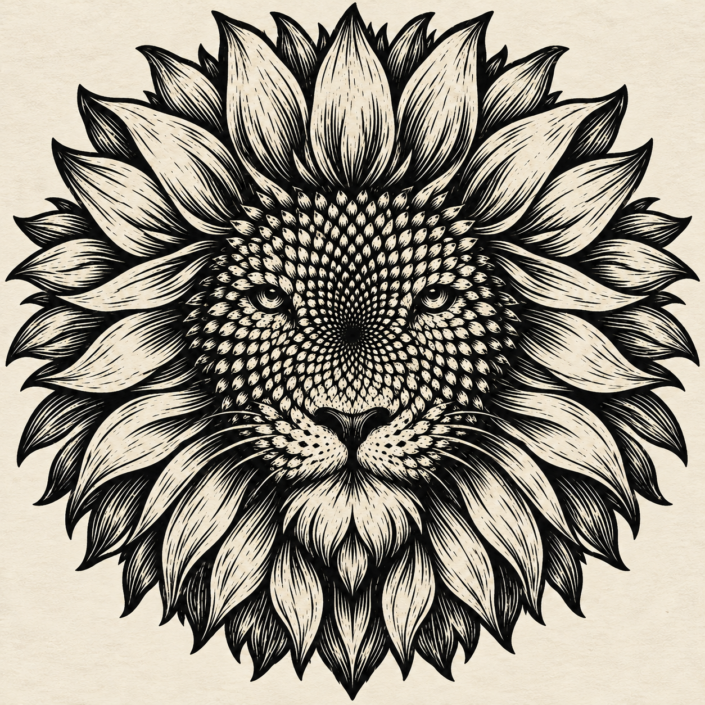
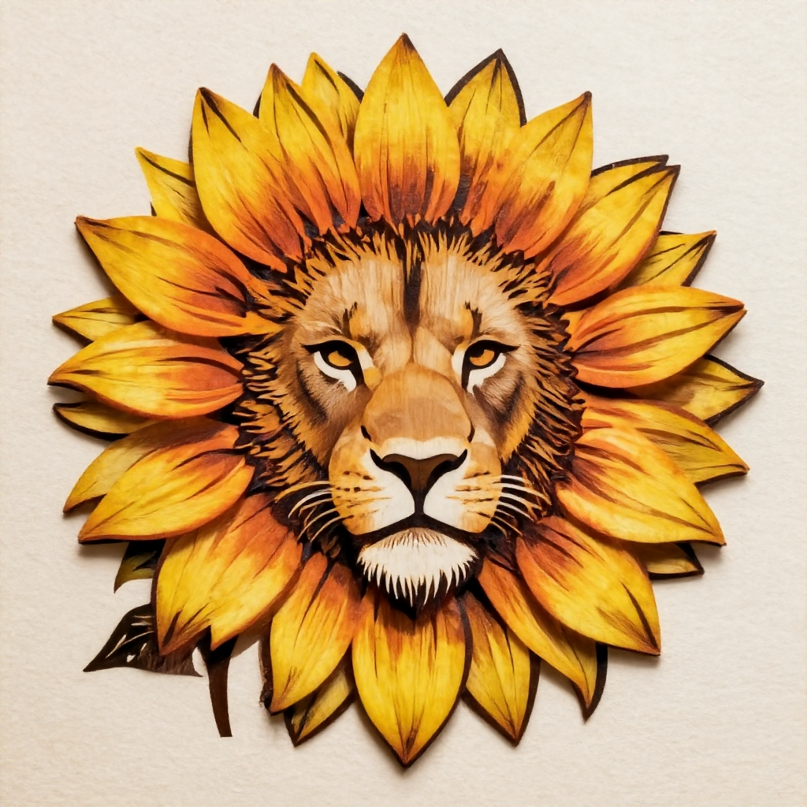

# Visual Anagrams with Flow Matching


A flow matching version of [visual_anagrams](https://github.com/dangeng/visual_anagrams). The code uses [L2P](https://nju-pcalab.github.io/projects/L2P/), a pixel-space flow-matching text-to-image model, to generate visual anagrams. These are images that change appearance or identity when transformed, such as by a rotation, a color inversion, or a jigsaw rearrangement. Read the [original paper](https://arxiv.org/abs/2311.17919) for more details.

## Installation
### Conda Environment

Create a conda env by running (only on Linux):

```
conda env create -f environmentMin.yml
```

and then activate it by running 

```
conda activate visual_anagrams_min
```

### Model Weights
Download L2P, text encoder and tokenizer of Z-Image-Turbo:

https://huggingface.co/zhen-nan/L2P

https://huggingface.co/Tongyi-MAI/Z-Image-Turbo


## Usage

Run from the Visual Anagrams repository. Set the model paths once in your shell, replacing the placeholders with existing files:

```
l2p_args=(
  --main_model_path /path/model-1k-merge.safetensors
  --text_encoder_paths
    /path/Z-Image-Turbo/text_encoder/model-00001-of-00003.safetensors
    /path/Z-Image-Turbo/text_encoder/model-00002-of-00003.safetensors
    /path/Z-Image-Turbo/text_encoder/model-00003-of-00003.safetensors
  --tokenizer_path /path/Z-Image-Turbo/tokenizer
)
```
Then generate visual anagrams:
```
python generate.py "${l2p_args[@]}" \
  --name rotate_cw.village.horse \
  --prompts "a snowy mountain village" "a horse" \
  --style "an oil painting of" \
  --views identity rotate_cw \
  --num_samples 10 \
  --height 1024 --width 1024 \
  --num_inference_steps 50 \
  --cfg_scale 10.0\
  --cfg_scale_view 10.0\
  --seed 42\
  --save_metadata
```

Here is a description of useful arguments:

- `--name`: Name for the illusion. Will save samples to `./results/{name}`.
- `--prompts`: A list of prompts for illusions
- `--style`: Optional style prompt to prepend to each of the prompts. For example, could be `"an oil painting of"`. Saves some writing.
- `--views`: A list of views to use. Must match the number of prompts. For a list of views see the `get_views` function in `visual_anagrams/views/__init__.py`.
- `--num_samples`: Number of illusions to sample
- `--num_inference_steps`: Number of flow matching denoising steps to take.
- `--cfg_scale`: CFG scale for identity-view prompt.
- `--cfg_scale_view`: CFG scale for prompt corresponding to the view that is not identity. Defaults to cfg_scale.

### Animating

To animate the above two view illusion, we can run the below command. 

```
python animate.py --im_path results/rotate_cw.village.horse/0042/sample_1024.png --metadata_path results/rotate_cw.village.horse/metadata.pkl
```

Here is a description of useful arguments:

- `im_path`: The path to your illusion. This should work for any of the three image sizes.
- `metadata_path`: The path to metadata about the views and prompts used to generate the illusion, which is saved by `generate.py`. Overrides the options below.
- `view`: Name of the view. For a list of views see the `get_views` function in `views/__init__.py`
- `prompt_1`: Prompt for the original image. You can add `\n` characters here for line breaks.
- `prompt_2`: Same as `prompt_1`, but for the transformed image.

## More Examples
Flipping illusion:
```
python generate.py "${l2p_args[@]}" \
  --name flip.campfire.man \
  --prompts "people around a campfire" "an old man" \
  --style "an oil painting of" \
  --views identity flip \
  --num_samples 10 \
  --height 1024 --width 1024 \
  --num_inference_steps 50 --cfg_scale 10.0\
  --seed 42\
  --save_metadata
```

Color inversion illusions:
```
python generate.py "${l2p_args[@]}" \
  --name negate.landscape.houseplants \
  --prompts "a landscape" "houseplants" \
  --style "a lithograph of" \
  --views identity negate \
  --num_samples 10 \
  --height 1024 --width 1024 \
  --num_inference_steps 50 --cfg_scale 10.0\
  --seed 42\
  --save_metadata
```

## Custom Views

Views are derived from the base class `BaseView`. You can see many examples of these transformations in `views.py`, if you want to write your own view.

Additionally, if your view can be implemented as a permutation of pixels, you can probably get away with just saving a permutation array to disk and pasing it to the `PermuteView` class. See `permutations/make_inner_rotation_perm.py` and `get_view()` in `views.py` for an example of this.

## New feature
Rather than using a single CFG scale for all prompts as in the original repo, now each prompt has its own CFG scale. This enalbes finer control of the saliency of prompts, as a higher CFG scale makes the output image follow the prompt closer.

Results from running the following command with a fixed `--cfg_scale` and varying `--cfg_scale_view`(CFG scale of "a snowy mountain village" is 10, while that of "a horse" varies):
```
python generate.py "${l2p_args[@]}" \
  --name rotate_cw.village.horse \
  --prompts "a snowy mountain village" "a horse" \
  --style "an oil painting of" \
  --views identity rotate_cw \
  --num_samples 10 \
  --height 1024 --width 1024 \
  --num_inference_steps 50 \
  --cfg_scale 10.0\
  --cfg_scale_view \
  --seed 42\
  --save_metadata
```

cfg_scale_view = 3


cfg_scale_view = 7


cfg_scale_view = 10


cfg_scale_view = 20


As cfg_scale_view increases, the horse becomes more salient in the image.

Sometimes the model prefers one prompt over another. You can alleviate this by tuning their CFG scales. Try the following command to see for yourself:
```
for v in {2..10}; do
  python generate.py "${l2p_args[@]}" \
    --name "rotate_180.sunflower.lionFace.woodcut.${v}" \
    --prompts "a sunflower" "a lion's face" \
    --style "a woodcut of" \
    --views identity rotate_180 \
    --num_samples 10 \
    --height 1024 --width 1024 \
    --num_inference_steps 50 \
    --cfg_scale 10 \
    --cfg_scale_view "$v" \
    --seed 42 \
    --save_metadata
done
```
Some results from the `0048` folders:

cfg_scale=cfg_scale_view=10, lion dominates sunflower:



cfg_scale=10,cfg_scale_view=6:



cfg_scale=10,cfg_scale_view=4, sunflower and lion are neck-and-neck:



cfg_scale=10,cfg_scale_view=2, sunflower dominates lion:



An interesting application is creating a sunflower-to-lion-face animation by varying the guidance scale of the second view. With the seed fixed at 48 and `cfg_scale=10`, the GIF below cycles through the nine `0048/sample_1024.Rotate180View.png` images generated with `cfg_scale_view` increasing from 2 to 10. As the second view receives more guidance, the sunflower gradually gives way to a lion's face. Each frame uses the same 180°-rotated orientation; the transition comes from changing the guidance scale.



## Conventional generation using current image generators fail to produce visual anagrams

### Visual Anagram
Prompt:
```
Visual illusions are images that change appearance or identity when transformed, such as by a rotation, a color inversion, or a jigsaw rearrangement.  Generate a visual anagram.
```
GPT-image(accessed October, 2026) output:


L2P output:



### Sunflower and Lion Face
Prompt:
```
Visual illusions are images that change appearance or identity when transformed, such as by a rotation, a color inversion, or a jigsaw rearrangement. Generate this visual illusion: A woodcut of a sunflower that becomes a woodcut of a lion's face when rotated 180 degrees counterclockwise.
```
GPT-image(accessed October, 2026) output:



L2P output:



Both generate a combination of sunflower and a lion's face and ignore the rotation requirement.

## Performance

Inference uses 28756 MiB(around 28.1 GiB) of GPU memory. 50 inference steps take about a minute on one RTX 5090.
